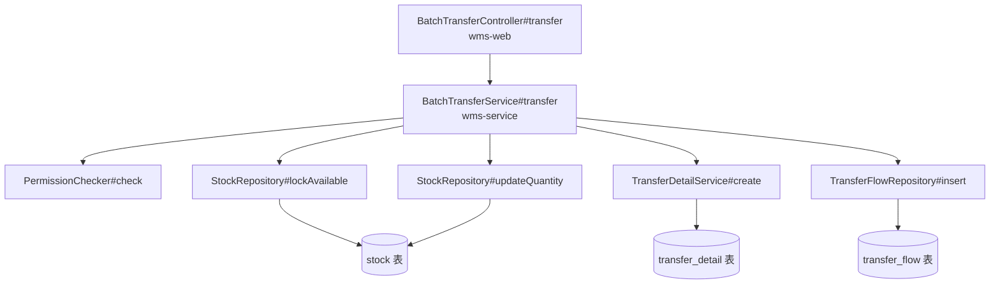

# 批量调拨 代码地图

## 结论

调拨请求从 `wms-web` 的 `BatchTransferController.java#transfer` 进入，由 `wms-service` 的 `BatchTransferService.java#transfer` 串起权限校验、库存锁定、明细生成、双仓扣减与流水记录五步；库存数量的读写只有 `StockRepository` 一个出口，其余代码只做编排与转换。

## 调用链

图分四段。第一段在 `wms-web`，只做参数绑定与权限拦截，不碰库存。第二段在 `wms-service` 的 `BatchTransferService#transfer`，依次调用库存锁定、明细生成、库存更新与流水写入，四步在同一个事务内。第三段是存储写入，`stock` 表被锁定与更新两次访问，`transfer_detail` 与 `transfer_flow` 各写一次。第四段是结果回写，通过消息回到 `wms-web`，不在调用链的同步路径上。

## 结构维度

### 分层与包职责

| 模块 | 包或目录 | 职责 |
| --- | --- | --- |
| wms-web | `src/controller` | 参数绑定、权限拦截、转发请求 |
| wms-web | `src/client` | 调用 `wms-service` 的客户端封装 |
| wms-service | `src/service` | 编排校验、明细、库存与流水 |
| wms-service | `src/repository` | 库存与流水的唯一读写出口 |
| wms-service | `src/converter` | 物料名称与编码互转 |

职责边界清楚：`wms-web` 不出现库存字段的计算，`wms-service` 不出现页面参数校验。跨层调用只允许从上到下，`repository` 不被 `controller` 直接调用。

### 关键类型

| 类型 | 承载什么 | 被谁读写 |
| --- | --- | --- |
| `TransferRequest`（`wms-web/src/dto/TransferRequest.java`） | 来源仓库、目标仓库、物料编码与数量、操作人 | Controller 接收并校验，Service 读取 |
| `TransferDetail`（`wms-service/src/domain/TransferDetail.java`） | 单物料的调拨前后数量、明细状态 | Service 生成，Repository 落库 |
| `StockSnapshot`（`wms-service/src/domain/StockSnapshot.java`） | 仓库与物料的可用量、锁定量 | `StockRepository` 读写，Service 只读 |

`TransferRequest` 的数量字段是请求值，`StockSnapshot` 的可用量是加锁后的真实值，两者不能混用：校验用的是前者，扣减用的是后者。

## 深入阅读

- [流程与逻辑](02-流程与逻辑.md)：主流程、分支与关键实现点
- [跨项目链路](07-跨项目链路.md)：两个项目之间的调用边界与数据归属
