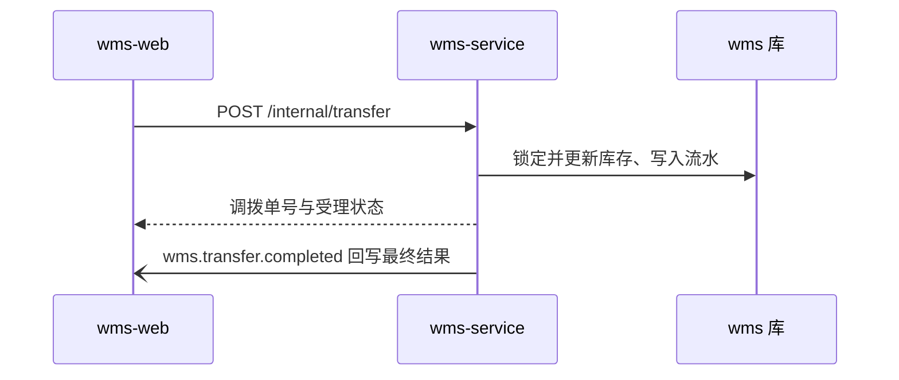

# 批量调拨 跨项目链路

## 结论

调拨由 `wms-web` 发起、`wms-service` 执行，库存与流水数据全部归属 `wms-service`；发起走同步 HTTP，结果回写走异步消息，`wms-web` 不持有库存副本。

## 跨进程边界

图里有两处跨进程交互。第一处是同步提交，`wms-service` 返回的是受理状态而不是最终结果，页面拿到单号后需要再查一次。第二处是异步回写，用消息把最终结果推给 `wms-web`，消息丢失时页面停留在「处理中」，由定时补偿补齐。

## 边界清单

| # | 发起方 | 承接方 | 协议 | 内容 | 代码位置 |
| --- | --- | --- | --- | --- | --- |
| 1 | wms-web | wms-service | HTTP `POST /internal/transfer` | 提交调拨单，返回调拨单号与受理状态 | `wms-web/src/client/TransferClient.java#submit` |
| 2 | wms-service | wms-web | 消息 `wms.transfer.completed` | 回写调拨结果与流水号 | `wms-service/src/producer/TransferEventPublisher.java#publishCompleted` |

第一处边界同步失败时整单失败，不做重试，由用户重新提交；第二处边界异步失败不影响库存结果，由补偿任务按调拨单号重发。

## 数据归属

| 数据 | 归属项目 | 流转路径 |
| --- | --- | --- |
| 库存数量 | wms-service | `wms-web` 只读展示，不写回 |
| 调拨明细与流水 | wms-service | 通过完成消息把结果同步到 `wms-web` 页面 |
| 操作人与权限 | wms-web | 随请求体传入 `wms-service`，不落库存库 |

库存数量只有 `wms-service` 能写，这条约束决定了第二个项目的任何改动都不能直接连库存库。操作人信息在两端都出现，但只有 `wms-web` 是权威来源。

## 深入阅读

- [功能概览](01-功能概览.md)：功能定位与触发方式
- [代码地图](03-代码地图.md)：调用链与分层职责
