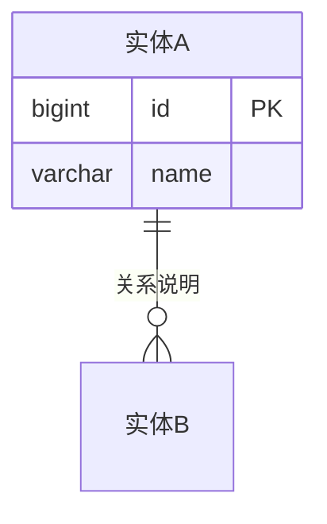
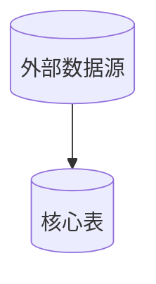
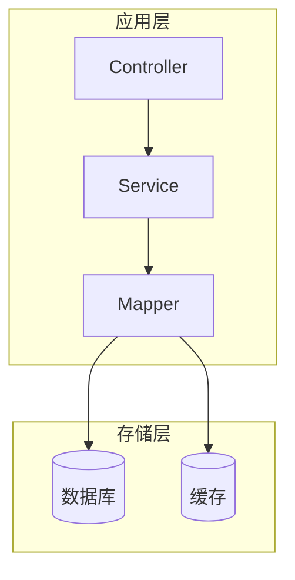
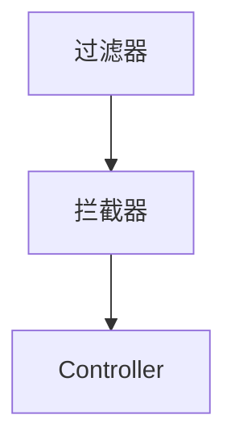
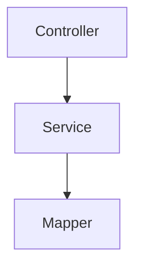

# 阶段二：文档骨架

一个主题写一篇独立文档，按技术主题拆分，不按字数切分。每篇包含该主题完整的信息，读者只读这一篇就能查到相关结论、数据、接口与源码位置；相对独立的子系统单独成篇。单篇过大时按子主题新增文档，不把同一主题切成互相引用的碎片。

每篇按对应骨架写。`[...]` 为待填占位；不需要的小节直接删除，不留空标题。标题层级不超过三级；类名、方法名、配置项、路径、命令保留原文。方括号占位约定只用于正文文字；mermaid 代码块里的方括号是图自身的节点语法，按图中写法使用，不当作待填占位。

信息形态与承载方式的对应关系按 `writing.md` 的规则选择，下方各骨架已示范正确用法。表格单元格只放能在一行读完的短值；长路径写进代码块或行内 code，不塞进单元格。

定位线索用名称级写法：目录树、Controller 名、类名、方法名、表名、配置键、URL；读者可据此在代码里检索到位置，不要求逐条给行号。代码可见的事实与推测分开写，推测标注「待确认」。

文件按 `序号-名称.md` 命名，序号沿用文档选项清单：`01-项目概览.md`、`02-功能清单.md`、……；相对独立的子系统用 `序号-子系统名.md`，如 `07-Honor荣誉排名子系统.md`。文档之间按需用相对路径链接，只链接本次实际生成的文档。

## 目录

- [项目概览](#项目概览)
- [功能清单](#功能清单)
- [数据库设计](#数据库设计)
- [接口清单](#接口清单)
- [架构设计](#架构设计)
- [部署说明](#部署说明)
- [子系统专题](#子系统专题)

## 项目概览

````markdown
# [项目名] 项目概览

## 1. 项目定位
**[一句话说明项目做什么、给谁用、解决什么问题]**

## 2. 技术栈
| 类别 | 技术 | 版本 |
|------|------|------|
[只列主导项；版本按实际配置填写，不自创]

## 3. 项目结构
```
[代码树：目录树，关键目录和文件后加行内注释说明职责；展开到能看清模块划分即可，不列每个文件]
```

## 4. 核心模块
| 模块 | 说明 |
|------|------|
[按功能域列，不按类名列]

## 5. 环境配置
| 环境 | Profile | [关键差异项，如注册中心、端口] |
|------|---------|------|

## 6. 入口类
`[全限定类名]`

## 7. 启动参数
```
[本地或生产 JVM 参数；无特殊要求时删此节]
```
````

## 功能清单

````markdown
# 功能清单

## 1. [功能域]（[Controller 或类名]）

### 1.1 [功能组]
| 功能 | 说明 |
|------|------|
[一列一个功能，说明控制在一行]

### 1.2 [状态流转或枚举]
[状态流转用代码块画箭头；枚举用短表格]

## 2. [功能域]
[同上，按功能域编号递增展开；N 为功能域总数]

## [N+1]. 数据来源
### [N+1].1 [外部系统或 SDK]
| SPI / Facade | 用途 |
|--------------|------|

## [N+2]. 枚举定义
### [N+2].1 [枚举名（用途）]
| 取值 | 说明 |
|------|------|

## [N+3]. 权限与缓存
| 权限码 / 缓存项 | 说明 |
|------------------|------|
[无权限或缓存要求时删此节]
````

## 数据库设计

````markdown
# 数据库设计

## 1. 概述
- 数据库与 ORM：[……]
- 库名、表前缀：[……]
- 公共字段与软删除约定：[……]

## 2. [业务域]表

### 2.1 [表名]（[中文名]）
[一句话说明这张表存什么]

| 字段 | 类型 | 说明 |
|------|------|------|

## 3. [业务域]表
[同上，按业务域分组，不按字母排；业务域表共 N 个，编号 2 至 N+1]

## [N+2]. ER 关系图

图 [N+2]：[核心业务域]实体关系。


实体名用裸标识符（中文或英文均可），不写方括号、不用别名；关系基数按实际改（`||--o{`、`}|--||` 等）。

## [N+3]. 表清单汇总
| 序号 | 表名 | 说明 |
|------|------|------|

## [N+4]. 数据流

图 [N+4]：[外部数据源]到核心表的数据流向。


````

## 接口清单

````markdown
# 接口清单

## 1. 通用说明
- 基础路径：[……]
- 认证方式：[……]
- 权限注解：[……]
- 响应格式：[……]

---

## 2. [模块]（[Controller]）
**前缀**: `[路径]`

### 2.1 [接口名]
- **URL**: `METHOD /path`
- **权限**: [权限码或认证要求]
- **参数**:
  - name: 说明（必填 / 可选）
- **响应**: `[类型]`

### 2.2 [接口名]
[同上；参数多时按请求体字段分组，不写进表格]

## 3. [模块]
[同上，按模块编号递增展开；模块共 N 个，编号 2 至 N+1]

## [N+2]. 接口统计
| 模块 | 接口数 | 认证要求 |
|------|--------|----------|
````

## 架构设计

````markdown
# 架构设计

## 1. 系统架构

图 1：系统分层与调用关系。


[前端、应用层、外部服务、存储、中间件分层，用 subgraph 分组；数据库等存储节点用圆柱形状]

## 2. 分层架构

图 2：各层及调用方向。


[画出各层及调用方向；横向分层用 LR]

## 3. 请求处理链

图 3：请求经过的过滤器、拦截器与 Controller。


[无统一拦截链时删此节]

## 4. 包结构
```
[关键包目录树，标注每包职责]
```

## 5. 关键设计模式
### 5.1 [模式或机制名]
[表格列组件与职责，必要时附配置或代码片段]
### 5.2 [模式或机制名]
[同上]

## 6. 外部依赖
| 依赖 | 协议 | 用途 |
|------|------|------|
````

## 部署说明

````markdown
# 部署说明

## 1. 构建
```bash
[构建、跳过测试、生成文档等命令]
```

## 2. 服务信息
| 配置 | 值 |
|------|-----|
[服务名、端口、启动类、关键前缀等]

## 3. 环境配置
### 3.1 Profile 切换
| Profile | 配置文件 | 说明 |
|---------|----------|------|
### 3.2 [多数据源或其他环境差异]
```yaml
[配置片段]
```

## 4. 外部依赖配置
[按依赖分小节，每节一段 yaml 代码块]

## 5. 本地开发
### 5.1 前置条件
- [……]
### 5.2 启动步骤
```bash
[本地启动命令]
```
### 5.3 测试
```bash
[测试命令；无测试约定时删此节]
```

## 6. 注意事项
[列表：登录/鉴权特殊处理、未继承基类的 Controller、缓存过期时间、超时与熔断等]
````

## 子系统专题

相对独立的子系统单独成篇，避免塞进主系统文档。按子系统特点取舍小节。

````markdown
# [子系统名]

## 1. 概述
[一句话说明子系统做什么、相对主系统的独立程度]

## 2. 架构

图 1：[子系统名]内部分层。


[子系统的 Controller / Service / Strategy / Mapper 分层]

## 3. 数据表
### 3.1 [表分组]
| 表名 | 说明 |
|------|------|

## 4. [核心实体]字段（[表名]）
| 字段 | 类型 | 说明 |
|------|------|------|

## 5. [关键机制]
[表格列组件与职责，附核心代码片段或配置]

## 6. 权限控制
| 权限码 | 说明 |
|--------|------|

## 7. 与主系统的关系

图 2：主系统与子系统的关系。


[后用列表说明独立性、共享性、数据隔离]
````
